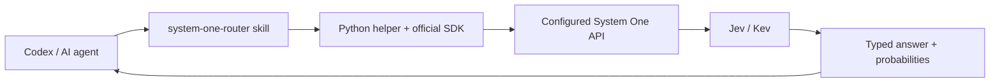

# Jev / System One Agent Integration

**Give Codex and other AI agents a System One decision layer for tool routing, classification, and prioritization.**

`jev-agent-skill` is a reusable agent skill that calls **Jev**, **Kev**, or another compatible endpoint and returns typed decisions to the agent. It handles execution and delegation with small Python scripts, using the official TypeSafe SDK.

[Jev](https://typesafe.ai) is TypeSafe's System One model: it answers bounded semantic questions with structured choices, yes-probabilities, or rubric scores instead of generating prose. [Kev](https://github.com/jaredpalmer/kev) is a separate open-source family of Jev-like decision models that exposes a compatible System One API. You can run Kev locally or on your own GPU host.

Use this integration when an agent needs to select a tool, triage messages, or classify many records before spending larger-model reasoning on selected cases. It works with Codex, Claude Code, and other agents that support the [Agent Skills format](https://agentskills.io/specification) and can run Python. The agent keeps control of tool execution. Latency and savings depend on your backend and workload; this project makes no benchmark claims.

## Quickstart

Requires Python 3.10+ and an existing System One-compatible server or TypeSafe account.
Run these commands from the repository root:

```bash
git clone https://github.com/RosarioDiBartolo/jev-agent-skill.git
cd jev-agent-skill
python -m venv .venv
```

Activate on macOS/Linux with `source .venv/bin/activate`, or on Windows PowerShell
with `.\.venv\Scripts\Activate.ps1`. If activation is restricted, run
`.\.venv\Scripts\python.exe` in place of `python`.

```bash
python -m pip install -r skills/system-one-router/requirements.txt
python skills/system-one-router/scripts/decide.py examples/tool-routing/request.json --validate-only
```

Configure your backend (macOS/Linux):

```bash
export SYSTEM_ONE_BASE_URL="http://localhost:8009"
export SYSTEM_ONE_API_KEY="local-unused"
export SYSTEM_ONE_MODEL="kev-latest"
```

Or Windows PowerShell:

```powershell
$env:SYSTEM_ONE_BASE_URL = "http://localhost:8009"
$env:SYSTEM_ONE_API_KEY = "local-unused"
$env:SYSTEM_ONE_MODEL = "kev-latest"
```

The dummy key above is only for a local Kev server without authentication. For a remote
server, use its HTTPS API root and real token. For TypeSafe, use `https://api.typesafe.ai`,
your TypeSafe key, and `jev-latest`. **Do not append `/v1` to the API root.**

```bash
python skills/system-one-router/scripts/health.py
python skills/system-one-router/scripts/decide.py examples/tool-routing/request.json
```

The health check performs a small real inference. Both commands may incur provider cost.
The decision response contains `model`, `answers`, and `usage`; the tool label is under
`answers.tool.choice`, alongside probabilities and confidence. No tool is executed.
See [configuration](docs/configuration.md) for timeouts, retries, and troubleshooting.

## Integrating Jev with Codex and Claude Code

Install the companion and the separate official judgment-design skill:

```bash
npx skills add RosarioDiBartolo/jev-agent-skill --skill system-one-router
npx skills add typesafe-ai/skills --skill typesafe-ai
```

Select your agent when prompted; add `-g` for user-wide installation. Node.js is needed
for this installer, not for the Python helpers. For a manual install, copy
`skills/system-one-router` into your project's `.agents/skills/` for Codex or
`.claude/skills/` for Claude Code. Install the copied skill's `requirements.txt`
into the Python environment your agent uses and make the configuration available to it.

Then ask Codex:

> Use $system-one-router with the configured Kev endpoint to choose an available search tool for “Find Daniel's email about the invoice.” Show the decision and probabilities, then continue within my request.

The [official TypeSafe skill](https://github.com/typesafe-ai/skills) teaches judgment
design, state construction, and composition. This companion supplies execution helpers;
it does not copy, replace, or modify that skill. See [Codex integration](docs/codex-integration.md).

## Jev tool routing and bounded agent decisions

| Example | What it does | Run from the repository root |
| --- | --- | --- |
| [Tool routing](examples/tool-routing/README.md) | Select an available search tool or review | `python skills/system-one-router/scripts/decide.py examples/tool-routing/request.json` |
| [Email triage](examples/email-triage/README.md) | Reply need, urgency, category, and deeper review | `python skills/system-one-router/scripts/decide.py examples/email-triage/request.json` |
| [Classification](examples/classification/README.md) | Classify a GitHub issue and score impact | `python skills/system-one-router/scripts/decide.py examples/classification/request.json` |
| [Batch triage](examples/email-triage/README.md#batch-triage) | Process several records before agent review | `python skills/system-one-router/scripts/batch_decide.py examples/email-triage/records.jsonl` |

All example records are synthetic. Responses depend on the selected model; no sample
probability is presented as a measured result. Read the [CLI reference](skills/system-one-router/references/execution.md)
to supply your own JSON or JSONL requests via files or stdin.

## Using Kev as a Jev-compatible backend

The same scripts can call a local GPU, VPS, RunPod, or Kaggle server exposed through
Cloudflare Tunnel, provided it serves the compatible API and accepts bearer authentication.
Only endpoint, key, and model configuration change. An OpenAI chat-completions endpoint
is not sufficient. Follow the [Kev setup guide](docs/kev-setup.md) for the serving contract.

## System One versus LLM reasoning

| Task shape | Use |
| --- | --- |
| Exact rule, calculation, lookup, or parser | Deterministic code |
| Semantic choice over known candidates, classification, or rubric rating | Jev / System One |
| Open-ended generation, planning, missing evidence, or complex ambiguity | Main LLM / agent |

Choice and Score confidence describe distribution concentration, not guaranteed correctness.
Noul is a yes-probability and has no separate confidence. Evaluate thresholds on your
own labeled cases and preserve an escalation path. See [routing and escalation](docs/decision-policy.md).

## Architecture



The helpers never choose a provider implicitly, run an agent loop, or execute selected
tools. Read [architecture](docs/architecture.md) and the dated [compatibility research](docs/compatibility.md).

## Development

```bash
python -m pip install ruff==0.16.9
python -m unittest discover -s tests -v
ruff check .
ruff format --check .
```

Tests use the real SDK against controlled responses and a local HTTP server; they need
no GPU, credentials, or paid API. CI checks Windows, macOS, and Linux. Live inference
quality must be evaluated on your deployment. See [contributing](CONTRIBUTING.md).

## Attribution and license

This is an independent community project and is not affiliated with or endorsed by TypeSafe.
Jev is a TypeSafe product; Kev is a separate project by Jared Palmer and contributors.
The [official TypeSafe repository](https://github.com/typesafe-ai/skills) remains separate
and unmodified. This integration is [MIT licensed](LICENSE); dependencies and models
retain their own licenses.
